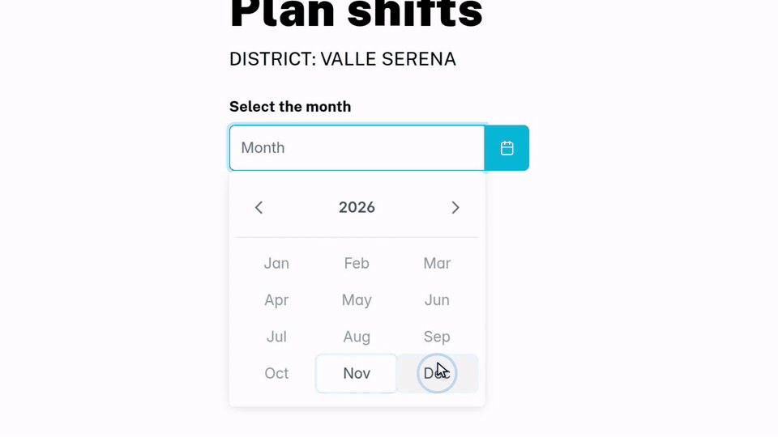
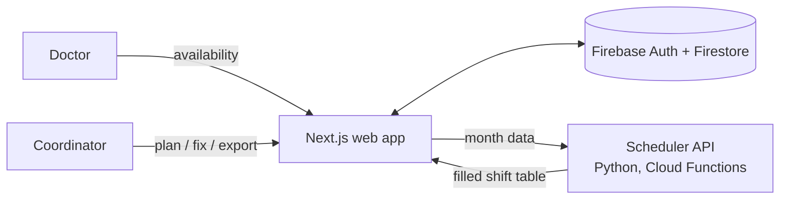

# MedCalendar

**Monthly shift scheduling for out-of-hours medical services.** Doctors submit the days they can work, the district coordinator plans the whole month with one click, fixes what the algorithm could not cover, and exports the result to Excel.

[](https://github.com/SamuMazzi/MedCalendar/releases/download/demo-video/medcalendar-demo.mp4)

▶ **[Watch the full demo (56 s, MP4)](https://github.com/SamuMazzi/MedCalendar/releases/download/demo-video/medcalendar-demo.mp4)**. The demo uses fictional districts, sites and doctors.

---

## What it does

| | |
| --- | --- |
| **Availability collection** | Each doctor picks the month, a maximum number of shifts, the sites they can cover and the days they are free for each shift (night 20-8, weekend day 8-20 and any special shift), then confirms a summary. |
| **District management** | The coordinator manages doctors (name, e-mail, role, sites) and adds special shifts on specific days (holidays, extra coverage). |
| **One-click planning** | The month's availability is sent to a scheduling service, which fills the shift table across all sites. |
| **Gaps and conflicts stay visible** | Uncovered shifts are shown as *(Empty)*. Any slot can be reassigned from a dialog that lists the available doctors and their remaining shifts. Doctors pushed past their limit are flagged with a warning instead of being hidden. |
| **Roles** | Full-time, temporary and substitute doctors are scheduled in priority order, each with its own shift quota, and colour-coded in the table. |
| **Excel export** | The confirmed schedule and the availability sheet are exported to `.xlsx`. |
| **Accounts and plans** | Passwordless e-mail-link sign-in or Google sign-in, district registration with a PayPal subscription. |

## How it works



- **Web app** (`web-app/`): Next.js 14 + React 18 + TypeScript, MUI and PrimeReact components, Redux Toolkit for state, Firebase Auth and Firestore for data, Sentry and Vercel Analytics.
- **Scheduler** (`API/`): a Python HTTP function (Google Cloud Functions, `functions-framework`) with a marshmallow request schema. It runs a backtracking search over the month's shifts in rounds (full-time, then temporary, then substitute doctors), respects each doctor's sites, availability and shift quota, and keeps the solution that fills the most shifts and satisfies the most doctors.

### Firestore layout

```text
users/{email}                                   name, role, locations
districts/{district}                            owners, locations, roles, doctors
districts/{district}/info/info_locations        sites, shift bands, special days
districts/{district}/info/info_doctors          doctors of the district
districts/{district}/availability/{yyyy-m}      day -> shift -> [doctor ids]
districts/{district}/shifts_month/{yyyy-m}      confirmed schedule
```

## Running it locally

Requirements: Node.js 18+, Python 3.10+, Java (for the Firebase emulators).

```bash
# 1. Firebase emulators (Auth + Firestore)
cd web-app
npm install
npx firebase-tools emulators:start --only auth,firestore

# 2. Scheduler API (port 8090; 8080 is used by the Firestore emulator)
cd API
python -m venv .venv && . .venv/bin/activate
pip install -r requirements.txt
functions-framework --target schedule_from_data --port 8090

# 3. Web app
cd web-app
npm run dev
```

The web app connects to the emulators when `NODE_ENV=test`. In development the scheduler is called on `http://127.0.0.1:8090` and in production on the deployed Cloud Function.

### Tests

```bash
cd web-app
npm run testJest       # unit tests
npm run teste2e        # Cypress end-to-end (starts the dev server)
```

## Repository structure

```text
web-app/
  pages/            routes: login, availability, planning, doctors, special shifts, registration
  components/       availability form, scheduling table, Excel export, registration and plans
  logic/            Redux slices, Firebase access (auth, Firestore), hooks, route guard
API/
  main.py           HTTP entry point (Cloud Function)
  scheduler.py      scheduling rounds
  models/           doctors, sites, shifts, solution search
  schema.py         request validation
```

## Author

Samuele Mazzi
